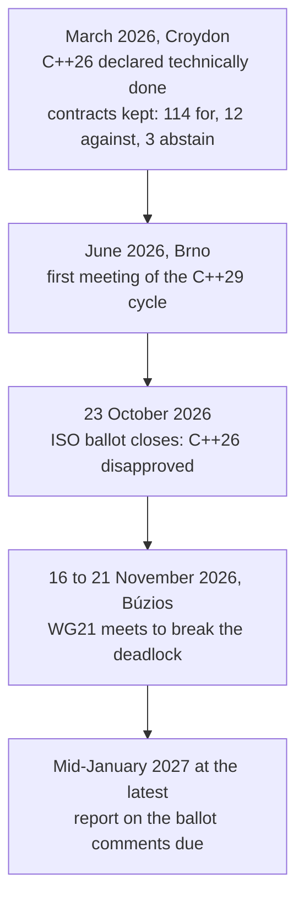

> **DRAFT NOTE:** the facts and links below are mine, checked against the sources at the bottom. Every block marked **TODO** is yours: your opinion, your experience, your bet. The cover is a placeholder too: replace `cover.jpg` with an Unsplash photo and fix the caption. Delete this note and the TODO blocks before publishing.

In March, the ISO C++ committee finished the technical work on C++26, and Herb Sutter called it "the most compelling release since C++11". On 23 October, the formal ISO ballot on that same draft closed, and national bodies **disapproved** it.

## What happened

At the March meeting in London Croydon the committee resolved the 411 national body comments from the 2025 ballot, added and removed no features, and kept **contracts** (`pre`, `post`, `contract_assert`) in the draft with a plenary vote of 114 for, 12 against and 3 abstentions. Bjarne Stroustrup had publicly opposed the feature, arguing that it is neither minimal nor viable and that it changes what code means depending on where it appears.

The draft then went to the international approval ballot (the DIS ballot). The result was posted on 24 October by Robert Seacord, convenor of the C committee: "Disapproved". Andreas Fertig, a German WG21 delegate, notes it is apparently the first time a C++ standard draft has failed this ballot.

The rules are strict: at least two thirds of the voting members must approve, and no more than a quarter of all votes may be negative. ISO policy does not let national bodies publish how they voted, and the comments are not public yet, so the exact numbers and the reasons are unconfirmed. Mateusz Pusz, who sits on the Polish national body, is convinced contracts were the issue, based on the objections raised before the vote.

## What happens next

Under the ISO rules the SC22 chair has four options:

| Option | What it means |
|---|---|
| Revised draft, new ballot | Fix the draft and vote again (a shorter, eight-week ballot) |
| Revised committee draft | Send it back to the committee stage for comments |
| Technical Specification | Publish the draft as a TS instead of a standard |
| Cancel the project | The only option that needs a full SC22 decision |

Inside the committee two camps have formed. One paper (P4433R0, written by sixteen contracts supporters) proposes going back to ballot without changing contracts. On the other side, people such as J. Daniel Garcia, co-author of a paper asking national bodies to vote No, argue that removing contracts would let the rest of C++26 pass, while Pusz considers removal unrealistic for the schedule. Every path needs a majority in WG21, which voted strongly for contracts in March, so the outcome is genuinely open. The first full meeting since the result is in Búzios, Brazil, from 16 to 21 November. One paper estimates the delay at months rather than years.

## What it changes for code you write today

**The language you compile is unchanged.** The standard in force is still C++23. Compilers keep implementing the draft: GCC 16 accepts `-std=c++26` and has contracts as an experimental feature, while Clang's implementation was not merged at the time of writing.

**The rest of C++26 is not the controversial part.** In his March report Sutter lists reflection, `std::execution`, and a set of memory safety improvements that need only a recompile: reading an uninitialized local is no longer undefined behavior, and the hardened standard library adds bounds checks to common operations. He reports that Google's rollout of the hardened library cost about 0.3% performance on average, fixed over 1,000 bugs and cut the segfault rate by about 30% across its production fleet. Those are server numbers, not real-time loops.

**Contracts in practice depend on a build flag.** A small experiment by Reticle on GCC 16.1 compiled the same function four times, changing only the contract evaluation semantic. The function had a postcondition that its bug violated:

| Semantic | Result |
|---|---|
| `ignore` | Exit 0, nothing reported, the bug goes through |
| `observe` | Exit 0, violation printed on stderr, the program continues |
| `enforce` | Violation printed, then abort (SIGABRT) |
| `quick_enforce` | Abort, with no message |

Caveats: it is one contrived example on one compiler, the semantics are implementation-defined, and the article comes from a company selling verification tooling. Still, the practical point stands: whether a contract check actually stops your program is a build setting, so it belongs in your CI configuration and your build logs.

> **TODO, your take (a few lines each):**
> - Which standard and which compiler does your team actually target, and does this ballot change anything for you?
> - Would contracts help in a simulation step, where invariants such as a positive time step or no NaNs in the state matter? Which semantic would you want in a debug build and which in a shipped one?
> - The hardened library costs 0.3% on Google's servers. Have you measured something like it on a hot loop of yours?
> - Your bet for Búzios: new ballot, remove contracts, or Technical Specification?

> **TODO, optional experiment:** compile a tiny `pre`/`post` example on GCC 16 with the four `-fcontract-evaluation-semantic` values and paste your own output here. Real results from your machine are worth more than the summary above.

## Sources

- Mateusz Pusz, [The result of the C++26 DIS ballot](https://train-it.eu/blog/cpp26-contracts-the-ballot-result/) (25 October 2026)
- Andreas Fertig, [C++26 DIS failed, how does C++ survive?](https://andreasfertig.com/blog/2026/11/cpp26-dis-failed-how-does-cpp-survive/) (3 November 2026)
- Herb Sutter, [C++26 is done! Trip report: March 2026 ISO C++ standards meeting](https://herbsutter.com/2026/03/29/c26-is-done-trip-report-march-2026-iso-c-standards-meeting-london-croydon-uk/)
- Herb Sutter, [Trip report: June 2026 ISO C++ standards meeting (Brno)](https://herbsutter.com/2026/06/13/brno-trip-report/)
- The Register, [Contracts in C++26 and Stroustrup's objection](https://www.theregister.com/2026/03/31/cplusplus26_approved) (31 March 2026)
- Reticle, [C++26 failed its ballot over contracts: same code, four outcomes](https://www.reticle.sh/signal/2026-10-26-cpp26-contracts-ballot-same-code-four-outcomes)
