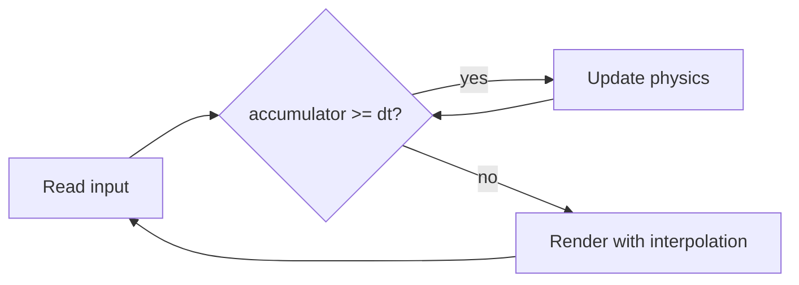

This is a test article: delete it (or turn it into the real first post) once everything looks right.

## Code, with line numbers and a copy button

A fixed-timestep loop, the classic way to keep a simulation deterministic while rendering at any frame rate:

```cpp
#include <algorithm>
#include <chrono>

using Clock = std::chrono::steady_clock;
using Seconds = std::chrono::duration<double>;

template <typename Update, typename Render, typename Running>
void run(Update&& update, Render&& render, Running&& running)
{
    constexpr Seconds dt{1.0 / 120.0};   // physics at 120 Hz
    constexpr Seconds maxFrame{0.25};    // avoid the spiral of death
    Seconds accumulator{0};
    auto previous = Clock::now();

    while (running())
    {
        const auto now = Clock::now();
        const Seconds frame = now - previous;
        previous = now;
        accumulator += std::min(frame, maxFrame);

        while (accumulator >= dt)
        {
            update(dt.count());
            accumulator -= dt;
        }
        render(accumulator / dt);        // interpolation factor in [0, 1)
    }
}
```

And a small C# one, because both languages are welcome here:

```csharp
public readonly record struct LapTime(int Minutes, int Seconds, int Millis)
{
    public static LapTime FromMillis(int total) =>
        new(total / 60000, total / 1000 % 60, total % 1000);

    public override string ToString() => $"{Minutes}:{Seconds:00}.{Millis:000}";
}
```

Inline code like `std::chrono::steady_clock` looks like this.

## A diagram

Written in Mermaid, directly in the Markdown:



## An image


## A video

The ID below is just an example: replace it with the video you want.



## Comments and sharing

Comments are switched on or off per article with `comments: true` in the front matter, and the Twitter/X share button sits at the bottom of every article.
