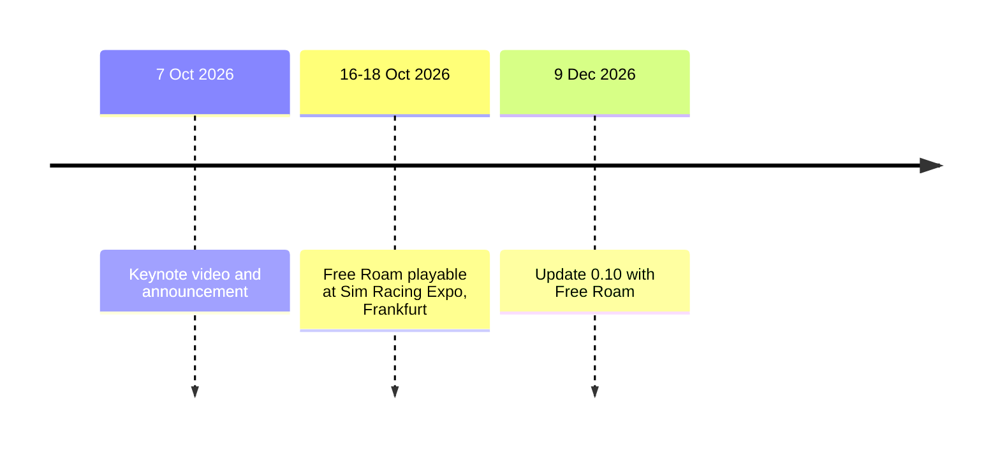

*Disclosure: I work at Kunos Simulazioni, on Assetto Corsa EVO. Everything in this post comes from public sources, and the opinions are mine.*

It is one month to the day: the **0.10 update**, with Free Roam, is scheduled for **9 December 2026**. The press release calls it the most ambitious content update since Early Access began, so it is worth a look at what has been shown so far.

## What we know

Free Roam is an open world built around the Eifel region in Germany, at **1:1 scale**. According to the [official announcement](https://assettocorsa.gg/assetto-corsa-evo-free-roam-revealed/):

- **The map**: the Nürburgring and its 20.8 km Nordschleife, the villages around it and the roads connecting them, with landmarks and points of interest. Road length and width match the real ones, and corners, hairpins, junctions, bridges and elevation changes follow their real counterparts.
- **At launch** the playable area covers the Nordschleife, the nearby villages and the connecting roads. More areas of the Eifel are planned to be added over time.
- **A living world**: changeable weather, a full day and night cycle, and AI traffic that varies depending on local trends.
- **Single player and multiplayer**: you can explore alone or together, and take part in dedicated game modes.
- **Optional activities**, such as Time Attack challenges.

The game is on PC through Steam in Early Access. The press release does not mention the price of the update or a list of cars for Free Roam, so I will not guess.

The first public hands-on was announced for Sim Racing Expo in Frankfurt (16-18 October), with Marco Massarutto of Kunos presenting Free Roam on the main stage on Friday 16 October.

## The video



## Why I care

A circuit is a closed world: you know where you are, you know what happens after the next corner. A road is different, and the Eifel is a place where road and circuit touch. Free Roam adds something a lap timer cannot give: the journey from the village to the track, the traffic you share the road with, the weather changing while you drive. For a sim it is also a very different kind of stress test, because the car has to feel right at 200 km/h on the Nordschleife and at 50 km/h behind a van.

I can't wait for players to experience the joy of driving with complete freedom on the roads around the Nordschleife and to try out the activities featured along those beautiful roads.

My advice for anyone who’s never tried EVO is to start with Free Roam—partly because it offers a more road-oriented driving experience, closer to the real world, especially for those with no experience in actual racing—and then, after trying out the various cars available, move on to the tracks to compete.

If you drive while paying attention to the scenery and objects around you, you might find some interesting things... look for a rusty truck and let me know!

## Sources

- [Assetto Corsa EVO Free Roam revealed](https://assettocorsa.gg/assetto-corsa-evo-free-roam-revealed/), assettocorsa.gg, 7 October 2026
- [Assetto Corsa EVO: new Free Roam feature to launch on December 9th](https://www.gamespress.com/Assetto-Corsa-EVO---New-Free-Roam-Feature-to-Launch-on-December-9th), press release, 16 October 2026
